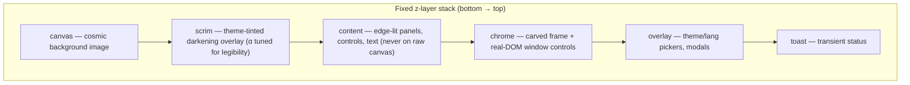

<!-- last-verified: 680a955 -->
# Visual design system — DPS-NN GUI

Design record for Task 2 of `plan/dps-nn-6.5.0-spec.md` (Opus). This fixes the **token architecture**
and the **consistency rules** that every theme implements, so all five themes read as one product.
It is the contract the Sonnet theme-implementation subtasks build against — parallel to how
`docs/explanation/gui-architecture.md` is the contract the wiring tasks build against.

It defines the *system*, not final pixels: the Sonnet impl chooses exact fonts, tunes exact colors,
and cuts the CSS. What it may **not** do is break a consistency rule or invent a token the system
doesn't name.

Derived from Stefan's reference art (eight background designs) and the mockup. Two hard constraints
from those references are baked in: the painted min/max/close in the background art is **decorative**
(functional chrome is real DOM on top), and a theme can suppress **structural** elements (the
Veselin Marinov theme hides the ДПС-НН logo because its art self-brands).

---

## 1. The design language — "Arcane HUD"

Every reference image, however different its subject, shares one meta-aesthetic: **an ornate carved
portal framing a deep-space scene, filled with glowing holographic instrumentation, with text set as
inscription.** That fusion — sci-fi HUD/terminal (the spec's "robotic hi-tech") × arcane cosmic
portal (the art) × baroque inscription (the ornate frames + display type) — is the shared language.
Call it **Arcane HUD**. It is what makes a gold Bulgarian-emperor theme and a molten soul-forge theme
feel like the same application.

The seven invariant grammar elements (identical in all themes; only their *dressing* changes):

1. **Layered depth, fixed z-stack.** `canvas` (cosmic background image) → `scrim` (darkening
   overlay) → `content` (floating panels) → `chrome` (window frame + controls) → `overlay` (modals,
   pickers) → `toast`. Nothing renders outside this ladder.
2. **The carved frame *is* the window border.** The Electron window is frameless; the ornate border
   is drawn by the app around the whole viewport. The functional min/max/close sit top-right as real
   DOM, always same position + behavior, styled per theme. The painted chrome in the art is never
   interactive.
3. **Edge-lit instrument panels.** Content lives in semi-opaque dark panels with a glowing
   accent-colored edge and a subtle inner shadow — the "readout" look. Same geometry and elevation
   across themes; only accent hue + frame ornament differ.
4. **Inscription typography.** Three roles — a *display* face (titles, theatrical), a *technical*
   monospace (terminal, HUD labels, code), a *body* sans (UI copy). The roles are invariant; the
   specific fonts change per theme (ornate gold serif for Imperator, techno-mono for Nova…).
5. **Glow is the light source.** Accent-colored bloom (text/box-shadow) is the unifying "energy"
   motif on active/live elements. It is how the UI signals aliveness in every theme.
6. **Run-control colors are semantic and fixed** (see §3 rule R2). Green/amber/cyan/red map to
   Start/Pause/Resume/Stop in *every* theme. Muscle memory and safety override theming here.
7. **Corner HUD ornaments + the sparkle mark.** A shared decorative system (corner circuit/rune
   accents, the bottom-right sparkle seen in the mockup) — recolored per theme, never re-invented
   into a different shape language per theme.



---

## 2. Token architecture (two tiers)

**Primitive tokens** (raw values, defined per theme) resolve into **semantic tokens** (roles).
Components reference **only** semantic tokens — never a raw color or a primitive. This is the whole
reason five themes stay maintainable: a component says `surface.panel`, and each theme decides what
that is. Adding theme #6 later is filling a descriptor, not touching a component.

### 2.1 Semantic token groups

| Group | Tokens | Notes |
|---|---|---|
| **Surface** (depth ladder) | `surface.canvas`, `surface.scrim`, `surface.panel`, `surface.panel-raised`, `surface.inset` | Near-black, theme-tinted. `inset` = terminal/input wells. |
| **Text** | `text.primary`, `text.secondary`, `text.muted`, `text.accent`, `text.inverse` | Contrast floors mandated in §6. |
| **Accent / brand** | `accent.primary`, `accent.secondary`, `accent.glow` | The theme's signature hue + its bloom color. |
| **State (fixed semantics)** | `state.start` 🟢, `state.pause` 🟡, `state.resume` 🔵, `state.stop` 🔴, `state.success`, `state.warning`, `state.danger`, `state.info` | Themes tune saturation/glow only; the mappings never move (R2). |
| **Frame / border** | `frame.ornament` (per-theme carved border asset/SVG), `border.edge` (panel edge-light), `border.hairline` | |
| **Effects** | `glow.sm/md/lg`, `elevation.panel`, `scrim.alpha` | Glow = the shared energy motif. |
| **Radius** | `radius.panel`, `radius.control`, `radius.pill` | Constrained band (§3 R7) so themes feel one family. |
| **Typography** | `font.display`, `font.technical`, `font.body`; scale `type.title/heading/label/body/mono/caption` | Roles invariant; faces per theme. |
| **Motion** | `motion.ambient`, `motion.pulse`, `motion.transition`, easing tokens | All gated by `prefers-reduced-motion` (§6). |
| **Z-layer** | `z.canvas/scrim/content/chrome/overlay/toast` | Matches §1 diagram. |

Concrete starting values (the impl tunes within these; they are the *shape* of the scale, not law):

- **Type scale** — title `2.25rem` / heading `1.25rem` / label `0.8125rem` (uppercase, tracked, HUD
  style) / body `0.9375rem` / mono `0.8125rem` / caption `0.75rem`.
- **Radius band** — panels `2–10px`, controls `2–8px`. Tech themes (Nova/Forge) sit sharp
  (`2–4px`, optionally clipped corners); arcane themes (Veil/Imperator/Enchant) sit softer
  (`6–10px`). Never outside the band — that's what keeps them sibling shapes.
- **Scrim** — a theme-tinted near-black at `55–75%` alpha over the background image, tuned per
  background to pass §6 contrast on panels. Panels themselves `78–88%` opaque.
- **Motion** — ambient background parallax `30–60s` loop; pulse (processing) `1.5–2s`; control state
  transition `120–180ms`; progress shimmer `2s` linear.

### 2.2 Theme descriptor schema

A **theme** is one descriptor. It carries color/type tokens **and structural overrides** (the
architecture doc's requirement — a theme toggles *structural* slots, not just recolors):

```jsonc
{
  "id": "nova",
  "displayName": "Nova",
  "family": "hud",                 // groups skins (see §4)
  "background": "images/bg/nova.jpg",
  "tokens": { /* primitive → semantic overrides for this theme */ },
  "fontPair": { "display": "...", "technical": "...", "body": "..." },
  "structure": {
    "showLogo": true,              // Imperator/VM sets false — its art self-brands
    "logoVariant": "hud",          // hud | arcane | rune | none
    "chromeStyle": "hud",          // ornament family for the window frame + controls
    "frameStyle": "circuit",       // circuit | baroque | runic | forged | astral
    "ambientMotion": "drift-slow"
  }
}
```

A **skin** is a lighter descriptor that inherits a theme's `structure` + component geometry and only
swaps `background`, `accent`, and optionally `fontPair` (see §4). This is how the reference art's
German / Islamic / Occult looks fit without spending a whole theme slot each.

---

## 3. Consistency rules (the hard-requirement part)

Decision #2 of the 6.5.0 spec makes cross-theme consistency a hard requirement. These are the
invariants. A theme that breaks one is a bug, not a style choice.

- **R1 — One layout, one component geometry.** All themes share the identical grid, panel geometry,
  control shapes, and screen structure. Themes recolor and re-ornament; they never restructure or
  move components.
- **R2 — Run-control semantics are locked.** Start = green, Pause = amber, Resume = cyan/blue,
  Stop = red, in every theme. Never remapped; never recolored past recognition. Safety + muscle
  memory beat theming here. (Maps to the run-control state machine in the architecture doc.)
- **R3 — Contrast floors are universal.** Every theme passes WCAG AA over its own scrim'd background:
  body ≥ 4.5:1, large/title ≥ 3:1, UI-control boundaries ≥ 3:1. The scrim alpha is *tuned per
  background* to hit this — a busy galaxy needs a heavier scrim than a sparse starfield. Non-optional
  (§6).
- **R4 — One motion language.** Same ambient-drift behavior, same pulse/transition timings, same
  reduced-motion fallbacks across themes. A theme can't be jittery while another is calm.
- **R5 — Shared iconography + ornament system.** One icon set and one corner-HUD/sparkle ornament
  system, recolored per theme — not redrawn into a different visual language per theme.
- **R6 — Chrome is invariant + always real DOM.** Window controls: always top-right, same three,
  same behavior. The frame *ornament* changes; the interactive chrome does not, and is never the
  painted art.
- **R7 — One type system.** The display/technical/body roles and the type scale are shared even as
  the specific fonts change. Hierarchy and rhythm stay constant.
- **R8 — No text on raw canvas.** Text always sits on a scrim or a panel — never directly over the
  background image. This is the single most important legibility rule (§6).

---

## 4. The five themes (proposed instantiation) + the theme/skin model

The reference art shows ~8 looks; the spec fixes **5 themes**. Resolution: **5 theme *families*,
each a full token+structure descriptor, with cultural variants riding as *skins*** (background +
accent swap on a shared structure). This delivers the visual variety of all eight looks within five
maintainable structures — and the count is not a ceiling on *looks*, only on *structures*.

> This lineup is a **proposal derived from your art — reallocate the five slots however you like.**
> The token system and rules above support any lineup; only the specific five below are a
> recommendation, not a decision.

| # | Theme (family) | Signature | Accent | Display type | `showLogo` | Notes |
|---|---|---|---|---|---|---|
| 1 | **NOVA** (hud) — *default* | Clean blue circuit/HUD; sharpest, most "robotic hi-tech" | Cyan-blue | Techno-mono | ✅ hud | The baseline every theme is measured against. Ties to "Нова Надежда". |
| 2 | **IMPERATOR** (baroque) | **Veselin Marinov photos only** — opulent, ceremonial, gold-baroque cosmos | Gold | Ornate serif (Cyrillic-first) | ❌ **none, always** | VM-exclusive: this theme has no other backgrounds. Art self-brands → logo permanently suppressed. The personal/meme theme. |
| 3 | **VEIL** (arcane) | Violet "forbidden-knowledge" portal; carved arcane instrumentation | Violet-magenta | Engraved/mystic | ✅ arcane | Hosts the **Islamic (Sufi)** and **Occult (Veil of Isis)** looks as **skins**. |
| 4 | **FORGE** (forged) | Molten soul-forge; aggressive, code-in-lava, angular | Ember red-orange | Industrial mono | ✅ hud | The "hell-tech" theme; hottest glow, sharpest frame. |
| 5 | **ENCHANT** (astral) | Cyan-magenta aurora + runic frame; ties to the SGA "language" | Aurora (cyan↔magenta) | Runic/arcane | ✅ rune | Home of the Standard Galactic Alphabet display font + enchant motifs. |

**Skins** documented from the art (inherit a family's structure, swap background+accent):
- **Islamic / Sufi** → skin of **VEIL** (violet base; Arabic-calligraphy background; astrolabe HUD).
- **Occult / Veil of Isis** → skin of **VEIL** (eye-of-providence background; same violet structure).
- **German (Das Deutsche Herz)** → skin of **NOVA** (black-red-gold accent over the HUD structure;
  German cultural background). Imperator is ruled out — it is VM-exclusive (see decision #1 below).

Naming note: **NOVA** deliberately echoes the app's tagline "Нова Надежда" (New Hope) and pairs with
the mockup's default look.

---

## 5. Component specs (token-driven)

Each component is specified in **semantic tokens**, so themes inherit them and only the tokens
resolve differently. Structure is invariant (R1).

- **Window frame + chrome.** Frameless window; carved `frame.ornament` border around the viewport.
  Top-right: minimize / maximize / close as real DOM buttons (`chrome` z-layer), each calling
  `window:minimize/maximize/close` (architecture doc IPC). Hover = accent glow. The title
  ("ДПС-НН — …") sits top-left in `font.display`; suppressed-logo themes still show the title text.
- **Theme switcher** (top-left, "Тема" in the mockup) — opens an `overlay` picker of theme families
  (+ skins nested). **Flag/language picker** (top-right) — flag PNGs from `images/`; selecting swaps
  the renderer string table; the SGA option is a **font swap over English**, not a translation.
- **Input panels** — two edge-lit `surface.panel` cards: *Спецификация* (spec) and *Осеменяване*
  (seed). Each: an **upload** control (`surface.inset` drop well) and a **list-select** dropdown
  (from `spec:list` / `seed:list`). The seed panel additionally has the **"Claude"** button
  (`accent.secondary`, distinct from the run controls) that triggers `seed:generateWithClaude`.
- **Run controls** — four buttons in a fixed row, semantic colors locked (R2): **Старт**
  `state.start`, **Пауза** `state.pause`, **Продължи** `state.resume`, **Спри** `state.stop`. Each
  has enabled / disabled / active states driven by the run-control state machine (a button is
  enabled only in the states where its transition is legal — e.g. Resume enabled only when Paused).
  Active/processing = `motion.pulse` glow.
- **Progress bar** — stage-granular (`index / total`, ~7–9 per the architecture doc), accent fill
  with a `2s` shimmer while running; turns `state.success` on completion, `state.danger` on error.
  Shows the current stage name as a `type.label`.
- **Debug terminal** — an `surface.inset` panel, `font.technical`, hosting xterm.js; toggled by the
  Debug-Mode checkbox; fed by the `build:log` stream. Scrollback, monospace, accent-tinted selection.
- **Generation / loading screen** — on Start, the app transitions to a full-bleed screen using the
  **per-project wallpaper** (image link from that project's spec) behind the scrim, with a loading
  animation and the progress bar. On completion, it resolves into a **readout** of the completion
  banner (URL, seeded credentials, DB, start command — from `report:get`). Test images stand in
  until real wallpapers are supplied (spec B.0).
- **Duplicate-detection dialog.** ADR-010 fixes dedup as GUI-side (spec+seed hash → the GUI's own
  manifest, no CLI change) but names no UI for it — this is that UI. A modal at the `overlay`
  z-layer, opened the instant `build:start` would fire against a hash already in the manifest
  (blocks the run, does not silently proceed or silently skip):
  - **Title**: "Дублиран билд" (Duplicate build). **Body**: the matched project's name, the
    timestamp of its last successful run, and its output path — three `type.label`/`type.body` rows,
    not prose.
  - **Three actions**, ranked left→right by how non-destructive they are, styled by intent rather
    than the run-control palette (this is a decision dialog, not a run control, so it does **not**
    borrow R2's colors — R2 is reserved for the run row):
    `Отвори съществуващия` (open the existing output folder, closes dialog, no pipeline call) as the
    quiet default action; `Генерирай отново` (proceed anyway — calls `build:start` with a
    force-regenerate flag) styled `state.warning`, since it is the one action with a real cost
    (overwrites/re-runs); `Отказ` (cancel, return to the setup screen) as a plain text action.
  - Keyboard: `Esc` = Отказ, `Enter` = the quiet default (open existing), never the warning action —
    a destructive-leaning path must never be the Enter-key default.
- **Toasts.** The `toast` z-layer (top of the stack, §1) — transient, non-blocking status that must
  never steal focus or cover the run controls. A bottom-right stack, newest on top, each an edge-lit
  `surface.panel-raised` pill with a leading state dot, one line of `type.body`, and an optional
  `type.caption` detail. Four semantic variants, colored by `state.*` (not the run palette): **info**
  (`state.info`, e.g. "Билдът стартира"), **success** (`state.success`, "Етап 6/9 завършен" /
  "Готово"), **warning** (`state.warning`, duplicate found, LLM key missing), **danger**
  (`state.danger`, stage failed). Auto-dismiss after `~5s` with a thin accent countdown rail; a
  hover pauses the timer; a manual **✕** dismisses immediately. `prefers-reduced-motion` → no slide,
  just fade; the countdown rail becomes a static bar. Toasts are cosmetic mirrors of events already
  visible elsewhere (progress, terminal) — never the *only* place a state is shown (a11y).
- **Completion / report readout.** The success resolution of the generation screen (`build:done` →
  `report:get`). A full-bleed `surface.scrim`'d screen over the project wallpaper, centered on a
  `surface.panel-raised` "readout card": a `state.success` header ("Готово — приложението е
  генерирано"), then a labeled `dl` of the completion banner — **URL**, **seeded credentials**
  (admin + demo user, each a copy-on-click `surface.inset` field), **database**, **start command** —
  in `font.technical`, `font-variant-numeric: tabular-nums`. Primary actions: **Отвори в браузър**
  (`accent.primary`, launches the URL), **Отвори папката** (opens the output dir), **Нов билд**
  (returns to setup). Credentials are the sensitive bit: shown, copyable, but never auto-logged to
  the terminal transcript.
- **Error / retry state.** The failure resolution (`build:error`). The progress bar turns
  `state.danger` and freezes at the failed stage; the debug terminal auto-expands and pins the
  failing line (a `state.danger` left-rule + the stderr tail). A readout card names **which stage**
  failed (e.g. `verify` — English-leak scan) and the one-line cause. Actions: **Опитай пак от този
  етап** (`accent.primary` — respawns `build:resume`, safe because stages are idempotent +
  checkpointed per ADR-010), **Пълен лог** (opens the full `dps-nn.log.jsonl`), **Спри**
  (`state.stop` — abandons the run, keeps `state.json`). Retry-from-stage is the default because the
  pipeline is resumable; a full restart is never forced on a recoverable stage failure.
- **Recent projects.** A `surface.panel` list opened from the setup screen (and empty-state on first
  launch), sourced from `logs/registry.json` — every past run without re-uploading spec+seed. Each
  row: project name (`type.heading`), last-run timestamp + status pill (success/failed/`state.*`),
  and its spec+seed handles as a `type.caption`. Click = rehydrate the setup screen with that run's
  inputs (re-selects the spec/seed, ready to Start or regenerate). A per-row **⋯** menu: open output
  folder, open in browser (if built), remove from list. This is the single biggest re-entry
  convenience; it reads the registry the CLI already writes, adds nothing to the CLI.
- **Settings panel.** An `overlay` modal (gear in the title bar) over `settings:get`/`settings:set`.
  Fields: **Anthropic API key** — a masked `surface.inset` field, **write-only** (never rendered
  back per the architecture doc; shows `••••••••` + a "заменен" state after a save, never the value),
  with a "Провери ключа" test action; **Genesis команда** — the CLI invocation override for power
  users / batch / debug (defaults to the bundled command; this is the "CLI stays first-class" seam
  from ADR-010); **Папка за изход** — default output directory; plus **тема** and **език** mirrors of
  the title-bar pickers. Save = `settings:set(patch)`; the key travels to the main process only and
  is injected into the child env there, never held in the renderer.

---

## 6. Accessibility & legibility (the real hazard)

Opulent text over a busy galaxy is where a naive "theme system" ships something beautiful and
unreadable. The system's defense is explicit and mandatory:

- **The scrim + panel discipline (R8).** No text ever sits on the raw background image. It sits on a
  scrim'd region or a panel. The `scrim.alpha` is tuned **per background** so that body text on
  `surface.panel` clears 4.5:1 — a denser image gets a heavier scrim. This is a per-theme QA gate,
  not a vibe.
- **Contrast floors (R3)** verified per theme against its own final background, not against a flat
  color: body ≥ 4.5:1, large/title ≥ 3:1, control boundaries ≥ 3:1.
- **Focus-visible** rings on every interactive element, drawn in `accent.glow` at a size that reads
  over any background (never a 1px hairline that vanishes on a bright nebula).
- **Reduced motion.** `prefers-reduced-motion: reduce` → ambient drift, pulses, and shimmer become
  static; state changes keep only instantaneous or ≤`120ms` transitions. The UI must be fully usable
  and calm with all ambient motion off.
- **Target sizes** ≥ 40×40px for the run controls and window chrome; the four run buttons are
  large, unmistakable, and never rely on color alone (icon + Bulgarian label + shape).
- **Color-independent state.** Because run-control identity is partly carried by fixed color (R2),
  each also carries an icon + label so it survives color-vision differences and the SGA/enchant
  theme's saturated palette.

---

## 7. What this fixes vs. what the impl owns

**Fixed here:** the Arcane HUD design language + its seven invariants; the two-tier token
architecture and the semantic token names; the theme-descriptor schema (incl. structural overrides);
the eight consistency rules; the five-theme + skin model; every component's token contract; the
legibility/a11y floors.

**Owned by the Sonnet impl tasks:** exact font selections, exact color values (tuned to pass §6),
the CSS/asset cutting, xterm.js theming, the loading animation, per-theme frame-ornament art, and
per-skin backgrounds. Build order follows spec B.0: **NOVA only, EN only, MVP first** — the full
token system implemented for one theme end-to-end before the other four themes and the six languages
are added. Getting NOVA right *proves the token system*; the rest are then descriptor fills.

---

## 8. Decisions (resolved)

1. **Five-theme lineup confirmed as proposed.** **Imperator is Veselin-Marinov-photos only** — no
   other background ever rides under that theme, and it never gains skins. German (Das Deutsche
   Herz) is therefore a **NOVA** skin instead, not an Imperator skin.
2. **Imperator suppresses the logo, always — no other theme does.** VM art self-brands; every other
   theme keeps `structure.showLogo: true` (or its family default).
3. **Default theme = NOVA**, unchallenged — stands as the mockup's blue HUD baseline.
4. The 8 uploaded reference images are near-final ("pretty much the same with minor corrections that
   won't affect the design") — treat their color/mood as reliable, not provisional, for token tuning.
   Real background assets land later in `images/bg/`; `design/preview.html` stands in with CSS-only
   approximations until then.
