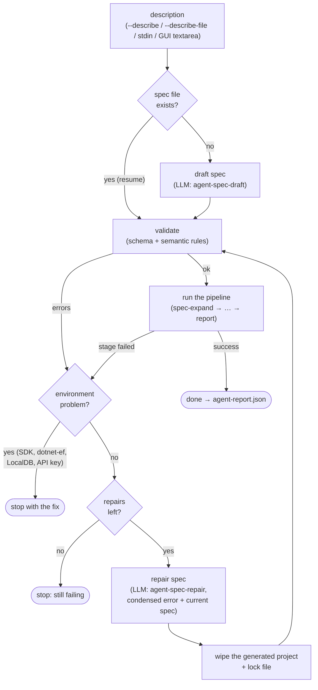

<!-- last-verified: b987364 -->
# Agent mode — from a description to a running app

**Diataxis type:** explanation. **Decision record:** [ADR-013](../adr/adr-013-agent-mode-spec-only-repair.md).
**Code:** `src/Genesis.Core/Agent/` (`AgentRunner`, `LlmSpecAuthor`), the `create` command in
`src/Genesis.Cli/Program.cs`, and `GenesisRunner.create` in `gui/src/main/genesis-runner.ts`.

## Why it counts as an agent

A workflow runs fixed steps; an agent observes the result of its own actions and decides what to
do next. dps-nn's generator is the agent's tool, and the generator's failures (validation errors,
build errors, verify-gate failures) are the observations it acts on. The model's only lever is
the spec — see ADR-013 for why it is never allowed to edit generated code.

## The loop



- **Draft** — the prompt is the repo's own spec-authoring guide
  (`utils/claude-skills/dps-nn-spec-authoring/SKILL.md`, frontmatter stripped) plus the FaceNote
  fixture as a known-good reference, plus a preamble that removes the guide's "ask the user"
  steps (nobody is there to answer) and adds the `unsupportedRequests` contract.
- **Validate** — `SpecLoader` (JSON Schema + semantic rules). The per-rule errors are what the
  model needs, so the loop sends `SpecValidationException.ToString()`, not `.Message`.
- **Run** — exactly what `run --all` does, minus the interactive seed picker. Failures are
  wrapped in `AgentStageException` so the loop knows *which* stage failed.
- **Condense** — build failures embed full STDOUT/STDERR. Anything over 6000 chars is reduced
  to the first line plus the distinct error/`CSxxxx` lines (max 60) before it reaches the model.
- **Environment triage** — matched on the *raw* error (before condensing) so a long log can't
  hide the telltale line. These stop immediately: no spec change fixes a missing tool.
- **Reset** — the old spec's project folder (only if it lies inside the output folder) and the
  lock file are deleted, so the next attempt regenerates from scratch rather than resuming a
  half-built project from the bad spec.

## The capability-gap report

When the description asks for something the schema cannot express (a booking calendar, a
payment provider, real-time chat...), the model must leave it out and record it:

```json
"meta": {
  "unsupportedRequests": [
    { "request": "календар за резервации на четения", "reason": "no scheduling/calendar feature-template" }
  ]
}
```

`create` prints the list and writes `<out>/agent-report.json` (`success`, `stopReason`, every
attempt with its stage and condensed error, `unsupportedRequests`, `models`). That list is the
backlog for new `feature-templates/` — the generator grows once, and every later run benefits.

## Running it

```bash
export ANTHROPIC_API_KEY=sk-ant-...
dotnet run --project src/Genesis.Cli -- create --describe "Онлайн книжарница с автори, отзиви и поръчки"
# or: --describe-file brief.txt   |   echo "..." | dps-nn create
# options: --max-repairs 3, --out <dir> (default out/agent_<timestamp>), --spec <path>,
#          --image-pack <dir>, --image-provider picsum|pexels|pixabay
```

Exit codes: `0` app generated, `1` agent stopped (reason + report path printed), `2` bad usage
(no description / no API key), `3` an LLM exchange is pending (manual paste flow, ADR-005).

Agent mode needs an API key: a manual paste per repair round would defeat the point. Without a
key, use the classic flow (`run --all` with a hand-written spec).

| Variable | Default | Used for |
|---|---|---|
| `DPS_NN_MODEL_SPEC` | `claude-sonnet-5-5` | spec draft + repair (`spec-build`, `spec-expand` review too) |
| `DPS_NN_MODEL_SEED` | `claude-haiku-5-5` | seed data |
| `ANTHROPIC_BASE_URL` | `https://api.anthropic.com` | proxies, test stubs |

## In the GUI

The Specification panel (Settings sheet) has a description box and a **Generate from
description** button. It calls `build:create`; the main process writes the text to
`<out>/agent_<stamp>/description.txt` and spawns `create --describe-file`. The project name is
unknown until the spec is drafted, so the runner polls `<out>/agent_<stamp>/project-spec.json`
for `meta.projectName` and re-targets the progress tail when a repair renames it (or restarts
the log after a reset). Progress, done and error events are the same as a normal run; on failure
the error screen shows the agent's own stop reason.

## Testing without an API key

`AgentRunner` takes the author, the pipeline and the validator as delegates — `AgentTests.cs`
drives every branch (green run, repair, environment stop, repair budget, draft failure, pending
propagation) with fakes. End to end, point `ANTHROPIC_BASE_URL` at a local stub that answers the
three exchanges (`agent-spec-draft`, `agent-spec-repair`, `seed`).
