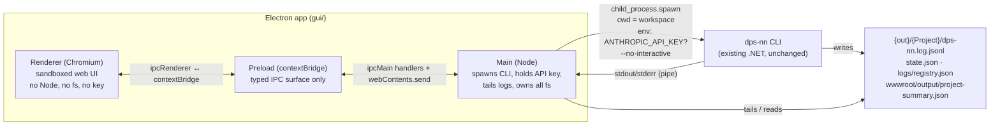
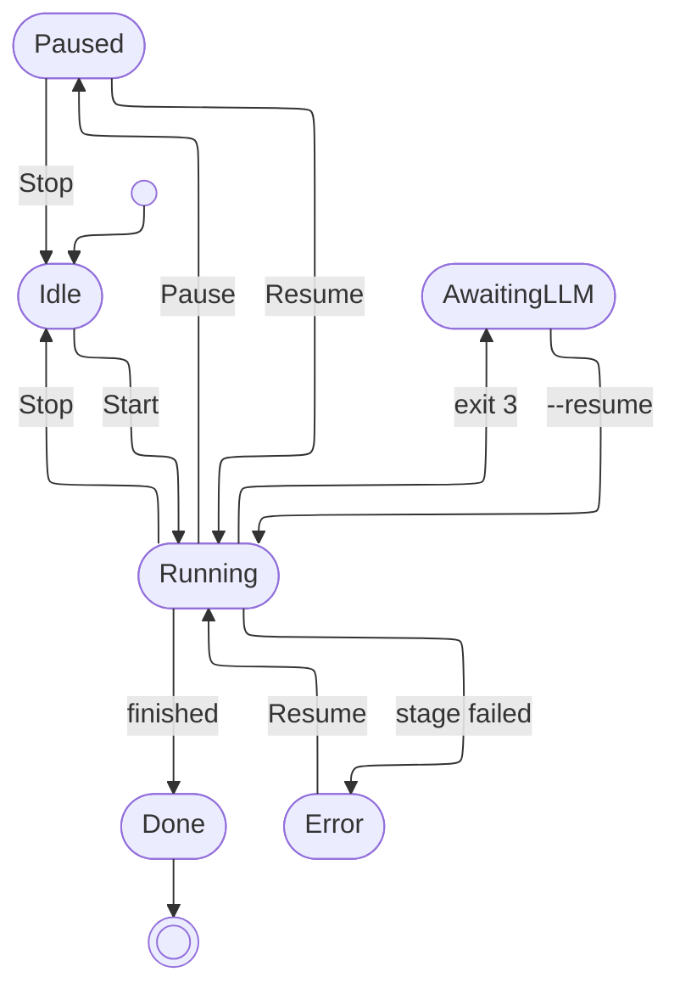

<!-- last-verified: 5821ff6f31c37384b3bf306ddf9ee24276324030 -->
# GUI architecture — Electron shell over the headless Genesis CLI

Design record for Task B of `plan/archive/dps-nn-6.5.0-spec.md`. This is the **architecture** every GUI
subtask (theming, i18n, process wiring, dedup, Claude-seed) builds against — it fixes the process
model, the GUI↔CLI contract, and the IPC surface. It does **not** cover visual design (theme tokens,
the 5 themes) — that is Task 2, `design/design-specs.md`.

Everything here is grounded in the *real* CLI contract, verified against `src/Genesis.Cli/Program.cs`
and `src/Genesis.Core/Pipeline/Pipeline.cs` at the stamped commit — not guessed.

## The one inviolable rule

**Genesis stays a headless CLI. The GUI wraps it as a child process and never reimplements pipeline
logic.** The GUI spawns `dps-nn run --all`, streams its output, and controls its lifecycle. It does
NOT drive stages one-by-one, parse-and-reimplement any stage behaviour, or move generation logic
into Node. Every temptation to "just do this one bit in the GUI" is the thing this rule forbids —
the CLI is the single source of truth for what a build *is*.

## Process model



- **Main process (Node)** — the only privileged layer. Spawns the CLI, holds the Anthropic API key,
  reads/writes the filesystem, tails the structured log, computes dedup hashes, reads the runtime
  footer. Nothing privileged happens anywhere else.
- **Preload (contextBridge)** — exposes a **small, typed** IPC surface to the renderer and nothing
  else. No raw `ipcRenderer`, no `fs`, no `child_process`, no `process.env`.
- **Renderer (Chromium)** — the web UI. `contextIsolation: true`, `nodeIntegration: false`,
  `sandbox: true`. It renders the screens, holds no secrets, and reaches the outside world only
  through the preload channels.
- **The CLI** — the existing `src/Genesis.Cli` binary, **unchanged**. The GUI adapts to its contract;
  the contract does not bend to the GUI.

## The GUI↔CLI contract (all verified against code)

| Concern | Contract | Source of truth |
|---|---|---|
| Invocation | `dps-nn run --all --spec <path> --out <dir> --no-interactive` | `Program.cs` run command |
| Working dir | **Must** be the workspace — the CLI writes `logs/`, `prompts/`, `dps-nn.log.jsonl`, `.image-cache/`, the registry relative to cwd, and reads `templates/`, `spec.schema.json`, `templates/features/` from its own `GenesisRoot()` (exe dir first, then cwd). In a checkout both are the repo root; installed, the install root is read-only and the workspace is `Documents\DPS-NN` (ADR-014) | `GenesisRoot()`, `Llm()`, `paths.ts` |
| Prerequisites | At startup the GUI runs `dps-nn doctor` once and streams it into the debug terminal (no new channel — it rides `build:onLog`). Informational only; a run started meanwhile waits for it to exit (two concurrent `dotnet run` builds of the CLI collide on Windows file locks) | `GenesisRunner.doctor()`, `Doctor` |
| No prompts | `--no-interactive` is **mandatory** — the GUI can't answer the CLI's stdin spec/seed pickers, so it replaces them with its own file/list UI and passes an explicit `--spec` + pre-places the seed at `prompts/in/seed-response.json` | `ResolveSpecInteractively`, `ResolveSeedInteractively` |
| API key | Injected into the **child env** by the main process when configured; never on the command line, never in the renderer | `Llm()` reads `ANTHROPIC_API_KEY` |
| Progress feed | `{out}/{Project}/dps-nn.log.jsonl` — one line per stage boundary: `{ ts, stage, phase: "start"\|"end"\|"error", durationMs, error }` | `PipelineRunner.AppendLog` |
| Checkpoints | `{out}/{Project}/plan/state.json` — `completedStages[]`; `run --all` skips done stages | `StateStore`, `RunAllAsync` |
| Resume | Re-run `run --all` (skips done via `IsDone`) or force a stage with `--from <stage>` | `RunAllAsync(ctx, fromStage)` |
| Manual-LLM wait | Exit code **3** = "waiting for a manual LLM response"; the run stops and expects a file at `prompts/in/<exchange>-response.json`, then `--resume` | `RunStage` catch, `LlmPendingException` |
| Completion | Banner on stdout (URL, seeded creds, DB, start cmd) **and** the machine-readable `wwwroot/output/project-summary.json` from the `report` stage | `PrintCompletionBanner`, `ReportStage` |
| Dedup input | `logs/registry.json` maps project → { specPath, seedResponsePath, outDir, ts } | `RecordProjectRegistry` |

Stage names the progress feed will emit, in order: `scaffold, emit-models, identity,
emit-controllers-views, seed, verify, report` (the 7 that `run --all` executes), preceded by
`spec-expand` (run before the pipeline loop) and, only in the `--notes` flow, `spec-build`. The
mockup's "stage N of 9" is therefore **approximate by design** (7–9 depending on flow) — which the
spec explicitly accepts.

## IPC channel surface (the typed contract)

The preload exposes exactly these, and nothing more. Names are the contract the renderer and main
both implement.

**Renderer → Main (request/response, `ipcRenderer.invoke`):**
- `spec:list` → available specs (fixtures/, prompts/out/schemas/, cwd)
- `spec:upload(fileBytes, name)` → copies into place, returns a handle
- `seed:list` → available seeds (seeds/, prompts/out/seeds/)
- `seed:upload(fileBytes, name)`
- `seed:generateWithClaude(specHandle)` → **main-process** Anthropic call, writes `prompts/in/seed-response.json`
- `build:checkDuplicate(specHandle, seedHandle)` → prior completed build for this (spec+seed) hash, or null
- `build:start(specHandle, seedHandle, outDir)` → spawns the CLI, returns a `runId`
- `build:create(description)` → agent mode (ADR-013): writes the text to
  `<out>/agent_<stamp>/description.txt`, spawns `create --describe-file`, returns a `runId`. Same
  push events as `build:start`; the runner learns the project name by polling the drafted spec
  (`gui/src/main/agent-helpers.ts`). Rejects when the description is empty or no API key is set.
- `build:pause(runId)` / `build:resume(runId)` / `build:stop(runId)`
- `settings:get()` / `settings:set(patch)` → theme, language, genesis-command, api-key
  (**write-only** from the renderer's view — the key is never returned)
- `footer:get()` → contents of `design/footer.md`, read at runtime
- `report:get(runId)` → parsed `project-summary.json` + parsed completion banner
- `recentProjects:list()` → every project the CLI's `logs/registry.json` has recorded a
  completed run for, newest first (read-only — the GUI never writes this file; the CLI's own
  `RecordProjectRegistry` in `Program.cs` owns it)

**Main → Renderer (push events, `webContents.send`):**
- `build:progress` → `{ stage, phase, index, total }` (index = completed-stage count, see below)
- `build:log` → a raw stdout/stderr line (feeds the xterm.js debug terminal)
- `build:awaiting-llm` → `{ stage, requestPath }` (exit 3 detected)
- `build:done` → `{ url, credentials, dbName, startCommand, outDir, summaryPath }`
- `build:error` → `{ stage, message }`

**Window controls** (because the window is frameless — see Theming): `window:minimize`,
`window:maximize`, `window:close`.

**Shell** (main-process `shell.*`, for the report-screen actions): `shell:openExternal(url)`
launches the generated app's URL in the OS browser; `shell:openPath(dir)` opens an output
folder. Both run in main — the renderer never touches `shell` directly.

**Run app** (`shell:runApp(dir)`): spawns `dotnet run --project <dir>` as argv, `shell: false`
— never a shell command string, so it can't hit the PowerShell-5.1 `&&`-parses-as-invalid
class of bug the CLI's own completion banner used to (changelog 083). Detached + unref'd so
the dev server outlives the GUI.

**Kill app** (`shell:killApp(dir)`): kills the process most recently launched by `shell:runApp`
for that project dir (tracked in a small main-process side-map keyed by dir, since `runApp`
detaches/unrefs it and it isn't part of the tracked pipeline `RunState`). Distinct from
`build:stop`, which cancels the CLI pipeline itself, not the generated app.

## Run-control state machine



| Transition | What happens |
|---|---|
| Start | spawns `run --all` |
| Pause | kills the child immediately (see below for why that is safe) |
| Resume (from Paused) | respawns `run --all`, which skips the stages already done |
| exit 3 | an LLM exchange is waiting for a response file |
| --resume | the response (e.g. the seed) is filled in and the run continues |
| finished | natural completion: banner + report |
| stage failed | a non-zero exit other than 3 |
| Resume (from Error) | re-runs from the failed stage; stages are idempotent |
| Stop | kills the child; `state.json` is kept |

**Why kill-to-pause is correct, not crude:** every `IStage.RunAsync` is contractually idempotent
and `MarkDone` only fires *after* a stage completes. So killing the child mid-stage leaves that
stage un-done in `state.json`; the next `run --all` re-runs only that stage (and its own internal
idempotency detects any partial work). Combined with checkpoints, this gives correct pause/resume
with **zero** mid-stage-freeze machinery — exactly decision #6 in the 6.5.0 spec.

**Pause kills immediately (not checkpoint-aware — corrected in changelog 102).** An earlier
version of this doc claimed Pause waits for the current stage's `"end"` line before killing; the
actual implementation (`GenesisRunner.pause`, unchanged since changelog 073) always kills
immediately, same as Stop. This is still CORRECT, not a bug: every stage is idempotent and
`MarkDone` only fires after a stage completes, so an immediate kill mid-stage just means that
one stage's partial work is discarded and re-run from scratch on Resume — never corrupted state,
only a small amount of wasted work confined to a single stage. A true checkpoint-aware pause
(wait for the in-flight stage's `"end"` line, then kill) is a possible future refinement, not
implemented.

**Stop keeps state (resolved).** On `Stop`, main kills the child but **preserves `state.json`**, so
the same (spec, out dir) can be resumed later via a fresh `run --all`. A separate explicit
"discard build" action is what clears the out dir — Stop alone never destroys work.

**One process per Start/Resume.** The GUI spawns a single `run --all` and controls its lifecycle.
It never orchestrates stage-by-stage CLI calls — that would be reimplementing `RunAllAsync` in Node,
which the inviolable rule forbids.

## Progress reconstruction (accurate across pause/resume)

On `Start`/`Resume`, main reads `state.json` first to get the baseline of already-completed stages,
then tails `dps-nn.log.jsonl` and increments on each `"end"` phase. `total` = the number of stages
that *will* run for this invocation (known up front). This keeps the bar correct even when a resume
skips half the pipeline (skipped stages emit no `"end"` line in the JSONL — they only log to stdout —
so the baseline read is what makes resume progress accurate). The debug terminal is fed separately
from raw stdout/stderr and is independent of this reconstruction.

## Claude-seed & LLM flow

The main process owns the API key (from env or local config); it never crosses into the renderer
(decision #4). Two modes, same underlying ADR-005 file contract:

- **Automatic** — key present → injected into the child env → every LLM-needing stage (`spec-build`
  if used, `seed`) self-serves. No exit-3 handling needed. This is the default when a key is set.
- **Manual / paste** — no key → the CLI exits **3** at the first LLM-needing stage, having written a
  request under `prompts/`. Main emits `build:awaiting-llm`; the renderer offers either a paste box
  **or** the **"Claude" button**, which triggers a main-process Anthropic call to fill
  `prompts/in/<exchange>-response.json`; main then respawns with `--resume`.

The "Claude" *seed* button specifically is the same mechanism scoped to the seed exchange: generate
`prompts/in/seed-response.json` from the chosen spec, in the main process, then proceed. Its detailed
design (model choice, prompt, cost) is Opus Task 3 — this doc only fixes *where* it runs (main) and
*what* it writes (the seed file the CLI already reads).

**Agent mode** (`build:create`) needs the key — every repair round is an exchange, so the paste
flow does not apply. Details: `docs/explanation/agent-mode.md`. Agent runs are not recorded in
the dedup manifest (there is no chosen spec+seed pair to hash).

## Dedup (entirely GUI-side, CLI untouched)

The 6.5.0 spec wants "(spec, seed) already built → skip". This lives wholly in the main process and
does **not** modify the headless CLI:

- On `build:checkDuplicate`, main computes `sha256(specBytes) + sha256(seedBytes)` and looks it up in
  a GUI-owned manifest `logs/gui-build-manifest.json` mapping the pair-hash → `{ outDir, ts, status }`.
- A completed match → the renderer offers "already built — open / regenerate anyway".
- On a completed build, main appends the pair-hash to the manifest.

This reuses the *idea* of the CLI's registry without depending on it or extending the CLI's own
formats. (The CLI's `StateStore.specHash` and `logs/registry.json` remain the CLI's business.)

## Theming & i18n seams (structure only; visuals are Task 2)

Task 1 must leave the right seams; it does not choose colours.

- **Frameless window + DOM chrome.** The window is `frame: false`. The title bar and the
  minimize/maximize/close controls are **real renderer DOM** drawn on top, wired to
  `window:minimize/maximize/close`. The painted min/max/close in the theme background art are purely
  **decorative** and are never interactive — a hard constraint from the reference designs.
- **Theme descriptors carry structural overrides, not just colour tokens.** Each theme is a
  descriptor `{ id, backgroundImage, tokens, showLogo, logoVariant, chromeStyle, ... }`. This is
  required because the **Veselin Marinov theme suppresses the ДПС-НН logo** (its art carries its own
  branding) — so a theme can turn *structural* elements on/off, not merely recolour them. The
  renderer's theme model must support per-theme show/hide of named slots (logo, frame ornaments),
  not a flat token map.
- **Runtime footer.** `design/footer.md` is read at runtime via `footer:get` (never bundled), so it
  can change without a rebuild. Empty/placeholder = render nothing, never error.
- **i18n.** String tables per language (EN, BG, DE, RU, TR, Romani) resolved in the renderer; the
  Standard Galactic Alphabet "language" is a **font swap over the English strings**, not a
  translation, and six joke modes (Morse, hex, sign, pirate, leet, upside-down) are encoders over
  the English strings — thirteen picker entries in all. All of this is renderer-local; the main process is language-agnostic. The chosen
  language persists through the existing `settings.language` field — **no new IPC channel**.
  **Built in phase 3b** (changelog 093): the six tables + a data-driven flag picker live under
  `gui/src/renderer/i18n/`; flags are **inline SVG**, not PNG (CSP-safe and self-contained — the
  renderer loads no external assets). SGA's glyph font (`Sga-Regular.ttf`, maps Latin A-Z to
  enchanting-table runes) is vendored at `gui/src/renderer/public/fonts/` and wired via
  `@font-face` in `styles.css` (changelog 095) — no longer deferred to the ENCHANT theme.
  **Hard boundary:** GUI-chrome language ≠ generated-app language — the latter stays
  Bulgarian-only (CLAUDE.md) unless the *spec's* `meta.language` says otherwise (changelog 054).
- **All 5 themes implemented** (changelog 101; `design/design-specs.md` §4 lineup, ported from
  the vetted `design/preview.html` token reference): NOVA (default), IMPERATOR (Veselin
  Marinov-exclusive, logo suppressed), VEIL, FORGE, ENCHANT. A top-left `theme-picker` (data-driven
  off `gui/src/renderer/themes.ts`'s `THEMES` registry, mirroring the language picker's pattern)
  swaps `.window`'s `data-theme` attribute; every component reads only CSS custom properties off
  that attribute (design-specs.md §2), so no other renderer code changed. Persists through the
  existing `settings.theme` field — no new IPC channel.
- **Real background images + skins (changelog 104)**: `design-specs.md` §8 decision 4's deferral
  is resolved — real art Stefan supplied (`design/backgrounds/*`) is vendored to
  `gui/src/renderer/public/backgrounds/` and wired as `--canvas-image` per `[data-theme]` block,
  layered UNDER the same gradient stack every theme already used (the gradients now function as a
  color-matched wash for legibility, not the whole background — R8/§6 contrast unaffected). Also
  added the 3 documented skins (`design-specs.md` §4 "Skins documented from the art"): NOVA hosts
  a German (Das Deutsche Herz) skin, VEIL hosts Islamic/Sufi and Occult/Veil-of-Isis — applied as
  a `data-skin` attribute alongside `data-theme` (`gui/src/renderer/themes.ts`'s `THEMES[].skins`),
  persisted through a new `settings.skin` field. IMPERATOR is VM-exclusive per decision #1 and
  never gains a skin. **Known cost, not addressed**: the 11 vendored PNGs total ~25MB, unoptimized
  — a compression/format pass (WebP, resizing) is a reasonable follow-up, not done here.
- **Loading screen (changelog 104)**: the full-bleed generation screen `design-specs.md` §5
  describes (wallpaper + animation + progress, replacing the setup screen while a build runs) is
  now built — previously progress only showed inline on the setup screen. Reuses the existing
  `.result-screen` full-bleed/scrim pattern (same as report/error); shows over the ACTIVE theme's
  wallpaper. **Per-project wallpapers (image link from that project's spec) are explicitly NOT
  implemented** — Stefan confirmed this scope: no `project-spec.json` schema change, the loading
  screen always shows the current GUI theme's wallpaper regardless of which project is generating.

## Security model

- Renderer: `contextIsolation: true`, `nodeIntegration: false`, `sandbox: true`.
- The API key lives only in the main process (env/local config); `settings:set` accepts it
  write-only, `settings:get` never returns it, and it is passed to the child **only** via env.
- The preload surface is the *entire* attack surface — keep it minimal and typed; no passthrough of
  `fs`/`child_process`/`ipcRenderer`.
- Uploaded spec/seed files are validated (JSON parse +, for specs, the existing `spec.schema.json`)
  in the main process before being written into place.

## Folder layout

```
gui/                         # the Electron app — sibling to src/, never contains pipeline logic
  package.json               # electron-vite build, node --test runner (Node >= 23.6 for .ts tests)
  src/
    main/                    # main process: owns fs, the API key, the CLI child
      index.ts               #   window + app lifecycle
      ipc.ts                 #   IPC handlers (the contract above)
      genesis-runner.ts      #   child lifecycle: start/create/pause/resume/stop, log tail, exit codes
      agent-helpers.ts       #   agent mode: project-name polling, stop-reason parsing (Electron-free)
      settings.ts paths.ts   #   persisted settings; installRoot() (read-only) / workspaceRoot() (CLI cwd), ADR-014
      dedup.ts report.ts     #   (spec+seed) dedup manifest, completion-banner parser
      recent-projects.ts registry-parser.ts files.ts footer.ts
      music.ts music-parser.ts media-protocol.ts
    preload/index.ts         # the typed contextBridge surface
    shared/ipc-types.ts      # channel names + payload types shared by main/preload/renderer
    renderer/                # the UI: index.html, main.ts, state.ts, themes.ts, styles.css, i18n/
  test/                      # node --test suites for the Electron-free modules
  scripts/stage-genesis.mjs  # stages the install root (self-contained dps-nn.exe + templates…) for packaging
  electron-builder.yml       # NSIS installer config (docs/how-to/build-the-installer.md)
```

**Packaged builds** (ADR-014): the install root is `<install>\resources\genesis\` (electron-builder
`extraResources`), the CLI command defaults to its bundled `dps-nn.exe`, and the workspace
`Documents\DPS-NN\` is created on first use with copies of the sample spec + seed. On boot the
renderer preselects that sample (`project-spec.facenote.json` from `fixtures`,
`facenote-rich-seed.json` from `seeds`) when nothing is chosen, so Start works without an API key.

`design/footer.md` and `design/music/` are read at runtime from the install root (the repo root in
a checkout); the wallpapers and logo are bundled into the renderer from `src/renderer/public/`.

## What this doc fixes vs. what later tasks own

**Fixed here:** process model; the CLI-child contract; cwd/`--no-interactive`/env-key constraints;
the IPC channel names; kill-to-pause + respawn-to-resume via idempotent checkpoints; progress
reconstruction; GUI-side dedup; the theming/i18n/security *seams*.

**Owned by later tasks:** the visual design system + the 5 themes (Task 2, `design/design-specs.md`);
the renderer framework choice and screen implementation; the Claude-seed prompt/model/cost design
(Opus Task 3); per-theme wallpapers and the loading animation. Build order follows the spec's B.0
phasing: **MVP first** — one theme, EN only, spec/seed input + dedup + Start/Stop + progress + debug
terminal + generation screen, generating end-to-end — before themes/languages expand.

## Resolved decisions

1. **The GUI is the primary way to run Genesis; the CLI stays a first-class parallel surface** for
   debugging and fast batch runs (the `1-build-and-check.bat` / `2-generate.bat` workflow). This
   *reinforces* the inviolable rule: the CLI must remain independently usable and testable, because
   the batch/debug workflow depends on it — the GUI is one caller among two, never the sole entry
   point. Concretely: main spawns via a configurable `settings.genesisCommand`, default to the dev
   form `dotnet run --project <root>/src/Genesis.Cli --` (same invocation the batch scripts use),
   overridable to a published `dps-nn` exe later. Nothing about the GUI may assume it is the only
   caller.
2. **Stop keeps `state.json`.** A later `run --all` can resume the same (spec, out dir). Clearing
   the out dir is a separate, explicit "discard build" action — Stop never destroys work.
3. **Pause waits for the current stage's checkpoint** (its `"end"` line) then kills — no wasted
   re-run. Immediate kill is retained only as a manual "force stop" fallback for a hung stage.
