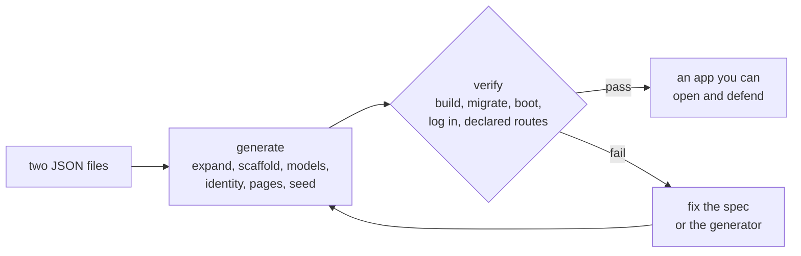

# One generation, from 30,000 feet

Before any machinery, follow a single project from a paper to a running app. Nothing in this chapter
is a command you must run; it is the arc that the rest of the book explains.

## The paper

A student arrives with four pages titled *Online Bookstore*. There are readers and administrators.
Books have authors, categories, prices and covers; readers browse, search, review, keep a
wishlist, and place orders; administrators manage the catalogue and the users. Non-functional
wishes: it must look modern, be entirely in Bulgarian, and be demonstrable on a laptop.

That is a normal, coherent requirements paper — and it is also a specification in disguise. What it
describes is *entities, relations, roles, pages, and rules*. What it does not describe is code.

## The decision: what becomes a sample app

The work starts with scoping. Three models of its own, not thirty: Book, Author, Category. Reviews,
the wishlist and orders come from three reusable features — `rating`, `catalogues` (a personal
list of books, which is what a wishlist is) and `orders` (cart, checkout, order history) — and
each brings its own models. Everyone can log in; administrators get the management
screens; readers get the storefront. Credit-card payment, e-mail delivery and a recommendation
engine are *named and dropped*, because the generator cannot express them and a half-wired
feature is worse than an honest omission.

## Two files instead of a codebase

The scope becomes two JSON documents:

- a **spec** — the three models with their Bulgarian labels (title, author, price), the validation
  rules ("price must be positive"), the two roles, the two areas, which pages
  exist and what kind each one is, the three features, and *how many* rows of demo data each
  model should get;
- a **seed** — the rows themselves: forty books with real titles, twelve authors, six categories,
  reviews with believable text, two orders with items.

Neither file contains C#. The input describes an application; it is not an unfinished one.

## The run

The student (or an agent) starts a generation. Eight things happen, in order, and each is observable
on the console:

- **Expand** merges the three features, pins the project's style (one of eleven deterministic
  axes), and derives the demo users' passwords.
- **Scaffold** creates an ordinary ASP.NET Core MVC project and compiles it once — a baseline that
  every later step must keep green.
- **Models** writes the entities — the three the spec declares and the ones the features added —
  their validation attributes with Bulgarian messages, and the
  EF Core context.
- **Identity** creates the role model, a Bulgarian login/registration/profile experience, an
  administrator account and a reader account.
- **Controllers and views** build the two areas: storefront pages with search and sorting, the
  admin tables, and the pages the features need: reviews, personal lists, cart and orders.
- **Seed** fills the database: books with downloaded cover images, reviews and orders that
  reference each other by name, and the EF migration that creates the schema.
- **Verify** decides the run: it builds, migrates, boots the app on a random port, logs in
  through the real form as the administrator, fetches every page the spec declares, and scans the
  rendered text for English. A single leaked "Add to cart" fails the run. The home page and the
  login must succeed outright, every declared page must answer, and every admin or login-only
  page must turn away an anonymous visitor.
- **Report** writes a machine-readable summary for whatever tooling wants to document the result.

## What the student sees

An app that starts on a laptop, with a populated catalogue, a working login, an admin area that
manages everything, and pages that look like a designed product rather than a scaffold. The
credentials are printed at the end of the run.

## What the examiner sees

Three things that are hard to fake:

1. **The run is on record.** The app was built, migrated, booted and logged into during
   generation, and the log says which pages answered. It is a file, not a claim.
2. **The Bulgarian requirement is mechanically checked.** The language report lists any English
   text, pass or fail.
3. **The code is ordinary.** There is no runtime framework in the generated app — if the student
   cannot explain a line, the generator is at fault, not the student.

## When it goes wrong

The interesting part of the story is the failure path. If a model is malformed, validation names
the model and property before anything is generated. If a feature cannot attach to the
project's main model, generation stops at expansion. If a file the spec promised is missing,
verify's manifest check names it before the app is booted. If the app will not boot, verify fails before scanning anything. In every
case the run is **resumable at the failing stage**, and the artefacts needed to diagnose it are on
disk.

The promise fits in a sentence: a paper goes in, a verified and explainable app comes out, and when
something fails the failure is located.

## Where the rest of the book goes from here

| Question this story raises | Chapter |
|---|---|
| What exactly does a generated app look like inside? | [3](03-what-a-generated-app-is.md), then [10](10-generated-app-architecture.md) |
| How do I run it myself? | [4](04-first-run.md) |
| How do I turn *my* paper into that spec? | [5](05-paper-to-spec.md) |
| Where does the demo data come from? | [6](06-spec-to-seed.md) |
| Can the model do the whole thing? | [7](07-agent-mode.md) |
| What precisely is each stage, and where can it stop? | [9](09-workflow.md) |
