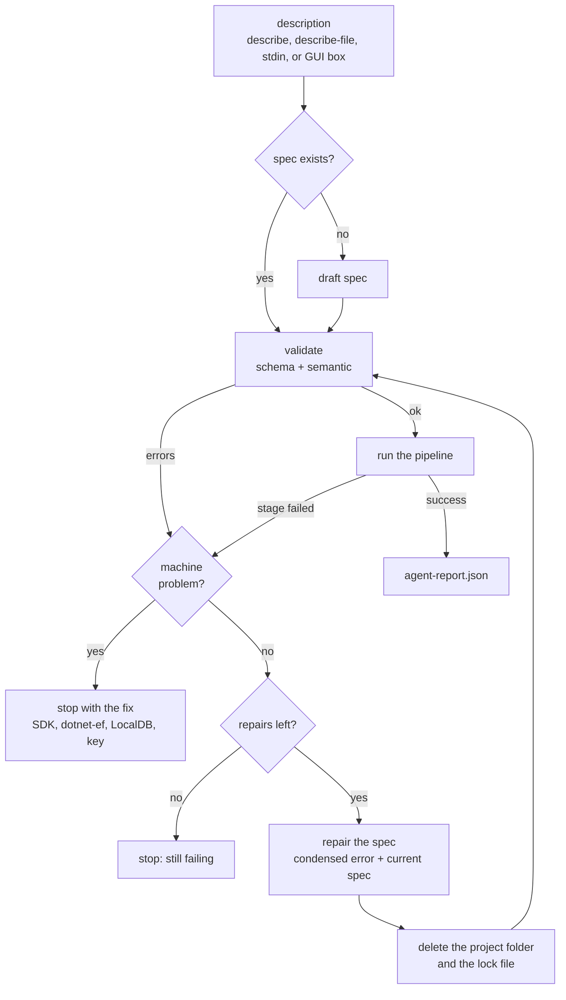

# Agent mode

Agent mode (`dps-nn create`) is the only part of the system that is an agent in the strict sense:
it observes the result of its own actions and decides what to do next. Everything else is a
pipeline; this chapter is about the loop on top of it.

## Why it counts as an agent, and why the lever is narrow

A workflow runs fixed steps. Here the steps are fixed but the *input to the next step* is chosen from
evidence: the model reads the generator's failure and edits the spec accordingly. What makes it
trustworthy is not the loop but the **lever**: the model may only change the spec (and the seed it
produces). It never edits generated C#, so every app it produces is still pure template output —
explainable, diffable, and reproducible from the spec alone.

## The loop



Three design choices in that diagram carry the weight:

- **Environment errors stop it.** A missing SDK, an old `dotnet-ef`, an unreachable LocalDB, a
  rejected API key — no spec edit fixes any of these, so the loop returns the fix instead of
  burning rounds.
- **Errors are condensed before they reach the model.** A build failure embeds the whole
  stdout/stderr; anything past 6000 characters is reduced to the first line plus distinct error
  lines (max 60).
- **A repair resets the output.** The old spec's project folder and lock file are deleted, so the
  next attempt cannot resume a half-built app produced by the bad spec.

The budget is `--max-repairs` (default 3). Every attempt, its stage and its condensed error land in
`agent-report.json`. The GUI's failure screen shows the stop reason, which it reads from the
CLI's `agent: stopped - <reason>` line on standard output; the full attempt list stays in the report.

## The capability-gap report

When the description asks for something the schema cannot express — a booking calendar, payments,
real-time chat — the model must **leave it out and record it**:

```json
"meta": {
  "unsupportedRequests": [
    { "request": "a booking calendar for the reading room",
      "reason": "no scheduling/calendar capability" }
  ]
}
```

That list is not decoration: it is printed, written to the report, and is the backlog for new
`templates/features/`. A tool that silently drops requirements is worse than one that names them.

## Running it

```bash
export ANTHROPIC_API_KEY=sk-ant-...
dotnet run --project src/Genesis.Cli -- create \
  --describe "Online bookstore: books, authors, reviews, cart and orders"
```

| Option | Meaning |
|---|---|
| `--describe "<text>"` / `--describe-file <file>` / stdin | the requirement text, any language |
| `--max-repairs <n>` | repair rounds before giving up (default 3) |
| `--out <dir>` | output root; defaults to `out/agent_<timestamp>` |
| `--spec <path>` | where the drafted spec is written — a resume with an existing file reuses it |
| `--image-pack`, `--image-provider` | as in a normal run |

Exit codes: `0` generated, `1` stopped (reason printed), `2` bad usage (no description, no key),
`3` an LLM exchange is pending.

**The key is required.** A manual paste per repair round would defeat the loop's purpose; without a
key, use the classic path from [Chapter 5](05-paper-to-spec.md).

## How it is tested without an API key

The loop takes its three side effects as delegates — the author, the pipeline, the validator — so
`tests/Genesis.Tests/AgentTests.cs` drives every branch with fakes: green run, one repair, environment
stop, exhausted budget, draft failure, pending propagation. End to end, `ANTHROPIC_BASE_URL` points
the bridge at a local stub that answers the three exchanges (`agent-spec-draft`, `agent-spec-repair`,
`seed`).

This is the pattern to copy for any new LLM behavior: put the decision in a plain class, pass the
effects in, and test the decision without a network.
