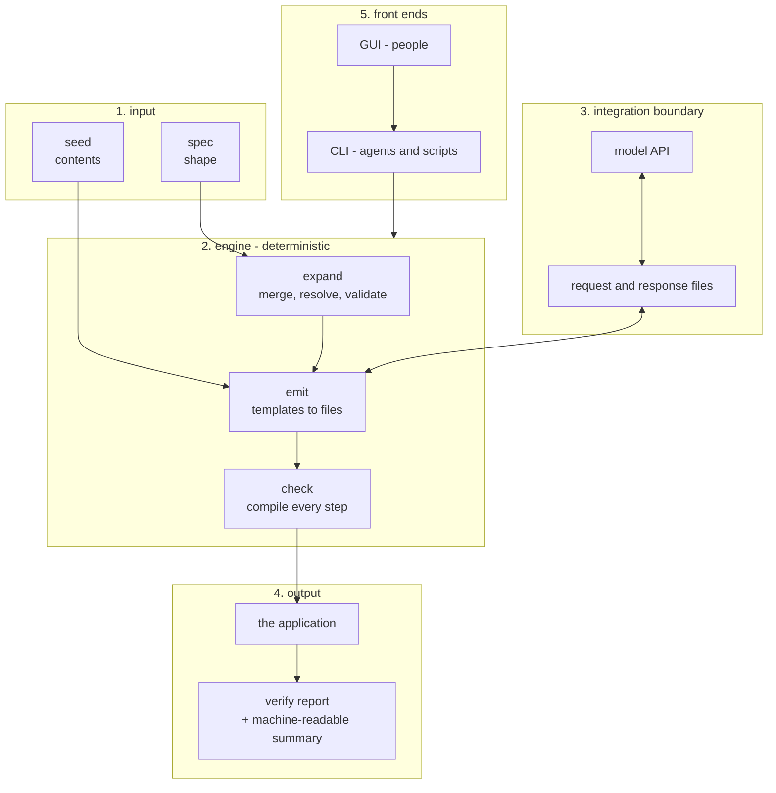

# The architecture, in one picture

Everything so far described what the system does. This chapter describes how it is put together —
the style, the boundaries, the patterns and the tools — so that the rest of the book has a frame to
hang on.

## One sentence, then the picture

Genesis is a **compiler with a verifier**: a declarative description goes in, a runnable application
comes out, and nothing is considered produced until the output has been built, started and read
back. Around that core sit two front ends and one mandatory boundary: every exchange with a language
model is a file on disk.

Follow the arrows from input to result and you get the guarantee: the only way to produce the output is
through the checks, and the only way to reach a language model is through files.

## The architectural style, named

| Property | How it is expressed | Why it is not the alternative |
|---|---|---|
| **Staged pipeline** | nine named stages, one `IStage` each; the runner drives seven of them in a fixed order after `spec-expand`, and `spec-build` runs on its own | a monolith cannot resume; a queue/distributed design would need infrastructure a laptop does not have |
| **Compiler-shaped** | spec is the source, the lock file is an intermediate representation, templates are the back end, `verify` is the test harness | "generate and hope" has no place to fix a wrong translation |
| **Externally checkpointed** | completion is a list of stage names in a JSON file, not in memory | a run must survive a crash, a reboot and a context reset |
| **Ports and adapters** | the engine knows nothing about HTTP, Electron or a terminal; the CLI is the adapter, the GUI is an adapter over the CLI | keeping presentation out is what makes the engine testable without a desktop |
| **Files as the integration contract** | prompts and responses, specs and seeds, logs and reports | an in-process API call makes the LLM path unauditable and untestable offline |
| **Deterministic core, non-deterministic fringe** | hashing for variation; migrations and model replies pushed to the edge | randomness inside templates would make every bug irreproducible |

## The patterns, and where each one lives

This is a pattern catalogue, not a claim of pattern purity. Each entry says where the pattern is, what
it buys, and where it stops paying.

| Pattern | Where | What it buys | Where it stops |
|---|---|---|---|
| **Pipeline / pipes-and-filters** | `PipelineRunner` over `IStage` implementations | resume, timing, per-stage failure attribution | stages cannot run concurrently unless they are independent |
| **Intermediate representation** | `project-spec.lock.json` | expansion happens once; every consumer reads one expanded form | the IR is a superset of the source, so it is not a minimal model |
| **Strategy + Template Method** | `IStage.RunAsync`; `ISpecAuthor`; controller provenance (`scaffold` / `template` / `writtenFromScratch`) | behavior varies without branching the runner | each new strategy owes idempotency and a build gate |
| **Adapter** | `LlmBridge` (API vs manual file exchange, one validation path); `Proc` (external tools) | two very different mechanisms behind one interface | a broken adapter surfaces as a stage failure, not a typed error |
| **Facade** | `TemplateEngine` | one rendering surface and one helper set, so every emitted file is consistent | a new template feature means adding to the facade |
| **Memento / checkpoint** | `StateStore`, `DbLifecycleRecord` | a run can stop and resume without redoing expensive work | state is a flat list, not a transaction log |
| **Registry** | variation axes, report code pointers, feature row-count defaults, picker candidates | adding a case is a data edit, not a control-flow edit | registries are hand-maintained and can drift from the templates |
| **Command** | the `System.CommandLine` tree; one command per stage | the same operation is both a CLI verb and a callable object | command handlers can accumulate orchestration |
| **Builder** | `scaffold` → models → identity → pages → seed | the project is constructed in dependency order, every step compiling | a failure midway leaves a partial project (by design: it is resumable) |
| **Anchored source rewriting** | scaffold deviations applied by regex on known shapes | cheap, and loud when the shape changes | brittle across SDK versions; ADR-006 accepts that trade |
| **Convention over configuration** | MVC area routing, controller and view discovery, page kinds | generated apps are ordinary ASP.NET with no bespoke wiring | conventions are invisible in the spec, so the docs carry them |
| **Dependency injection** | the generated `Program.cs`; `AgentRunner` taking its effects as delegates | services exist only when the spec asks; the agent loop is testable without a network | DI in generated code must stay small enough to read |
| **Fail-fast** | `Proc.ThrowIfFailed`, regex anchors that throw, schema-first validation | a wrong output is caught at the step that produced it | noisy when the environment, not the code, is at fault — hence `doctor` |

### The patterns deliberately absent

No repository layer over EF Core; no CQRS; no event bus; no service layer between controller and
`DbContext`; no orchestration framework; no dependency-injection container in the generator itself
(constructors are called directly, which keeps the pipeline readable top to bottom).

Their absence is a design position: every abstraction a reader meets has to earn its place in a
teaching artifact. [Chapter 10](10-generated-app-architecture.md) states the same principle for the
output.

## Coding style

### The generator

| Convention | Where it shows |
|---|---|
| .NET 10, nullable and implicit usings on; `LangVersion latest` in the engine | the `.csproj` files |
| File-scoped namespaces; `sealed` by default for concrete classes | every engine source file (the CLI's `Program.cs` uses top-level statements) |
| Records for values that travel together (`StageContext`, `ResolvedVariation`, `AgentFailure`) | pipeline and agent |
| Primary constructors for services that only hold their dependencies | `PipelineRunner`, `AgentRunner`, `TemplateEngine` |
| One public entry point per module; internals exposed to tests only through `InternalsVisibleTo` | `Spec`, `Stages`, `Util` |
| Exceptions inside, exit codes only at the CLI boundary | `Proc`, `Program.cs` |
| Culture-invariant formatting for anything a log or report shows | timings, versions |
| Hashing, never `GetHashCode()`, where reproducibility matters | variation |
| Templates are data: no C# string-building outside `TemplateEngine` | every stage |
| A one-line `// FILE-MAP:` header per file, generated into the file map | all of `src/` |
| Comments carry *why*, the rejected alternative, and the trap — not a restatement | the heavier stages |

The dependency direction is enforced by convention rather than by an analyzer: `Spec` and `Llm`
depend on nothing inside the engine, `Variation` and `Util` only on the spec side; `Stages` may use
all of them; nothing imports `Stages` except the CLI, and the agent reaches the pipeline only
through a delegate. [Chapter 13](13-components.md) lists the module boundaries.

### The generated application

Conventional MVC, with nothing clever to explain: entities with data annotations and Bulgarian
messages, controllers talking to the `DbContext` directly, Razor views with shared partials, inline
JavaScript for the small interactions, Bootstrap for layout. Services appear only when the spec
justifies them. The one unusual element is the image subsystem, because it owns files, caching and
fallbacks; everything else is what a competent developer would write without a generator.

## The problems, and the mechanism that answers each

| Problem | Mechanism |
|---|---|
| Building a coherent app by hand takes weeks | declarative input plus template emission |
| Demo data usually arrives late, or never | the seed is an input, and the app seeds itself at startup |
| Localization is added last and misses half the strings | Bulgarian is a hard requirement, and the language gate fails a run that leaks English |
| "It works on my machine" | the pipeline builds, migrates, boots and requests the app before calling it done |
| Two attempts at the same project look nothing alike | deterministic variation from a seed |
| Re-running a failed build wastes the whole run | per-stage checkpoints and idempotent stages |
| LLM output is untrustworthy and unauditable | file contracts, schema validation, hashed logs |
| The model fixes its own mistakes in code | the lever is the spec; generated code is never edited |
| A buyer cannot prove what they received | the report, the archive of spec and seed, and the run log |

## The tools, and what each was chosen over

| Tool | Used for | Why this one | Not this |
|---|---|---|---|
| **Scriban** | emitting C#, Razor and C#-adjacent text | text templating with a small, stable syntax that renders outside ASP.NET | Razor for generation (needs a hosting model, drags in MVC) |
| **System.CommandLine** | the command tree | one declaration of commands, options and help | hand-rolled argument parsing |
| **JsonSchema.Net** | spec and LLM-response validation | standards-based, reports every violation, not just the first | ad-hoc validation code that drifts from the schema |
| **EF Core + SQL Server** | the generated data layer | migrations, LINQ, and what the audience is expected to know | a micro-ORM (less teachable), a document store (wrong shape) |
| **ASP.NET Identity** | accounts and roles | standard, extendable, and familiar to an examiner | a bespoke auth layer |
| **xUnit** | the .NET suite | plain assertions, no mocking framework needed because seams are delegates | a mock-heavy suite that tests interactions instead of outcomes |
| **Electron + TypeScript** | the desktop shell | reuses web skills, ships on Windows, spawns the CLI | a native UI (double the surface for no gain) |
| **electron-vite** | GUI build | fast dev loop and the three build targets (main, preload, renderer) from one config | a hand-rolled bundler setup |
| **xterm.js** | the in-GUI terminal | real ANSI output from the CLI | a re-implemented log view |
| **NSIS** | the Windows installer | small, scriptable, per-user install | MSI (heavier, less scriptable here) |
| **GitHub Actions on Windows** | CI | the product ships on Windows: the installer is NSIS and is built on the same runner image | Linux-only CI, which never sees the platform users install on |
| **Git LFS** | the music assets | keeps a 1 GB media folder out of normal clones | committing media into history |
| **Mermaid + pandoc + XeLaTeX** | this book | diagrams as diffable source, one Markdown tree feeding a typeset PDF | a word processor, or images of diagrams |

## What makes it stand out

Six claims, each one checkable in this book:

1. **"Done" is a verified run**, not a compiled project. Build, migration, manifest, boot, login,
   the declared routes, anonymous refusal, language — in that order, cheapest first
   ([Chapter 9](09-workflow.md)).
2. **The LLM is a bounded lever.** It writes JSON; it never writes the app. Every failure it sees is
   a real generator failure, and every request it makes is a file someone can read later.
3. **The same spec is reproducible, and different specs are not clones.** Determinism and variety are
   both engineered, not left to chance ([Chapter 12](12-principles.md)).
4. **One pipeline, two front ends.** The GUI has no generation logic of its own, so the two cannot
   disagree ([Chapter 18](../explanation/gui-architecture.md)).
5. **The generated code is ordinary.** No runtime framework, no bespoke abstractions — the owner can
   explain every line, which is the whole point of a diploma artifact.
6. **The documentation is part of the architecture.** A router file, decision records, a changelog
   and a decision log mean a new session can reconstruct the reasoning without asking
   ([Chapter 15](15-how-the-project-is-built.md)).

## How to read the code from here

| Question | Chapter |
|---|---|
| What exactly does each stage do, and where can it stop? | [The end-to-end workflow](09-workflow.md) |
| Which files come out, and how are they layered? | [What gets generated](10-generated-app-architecture.md) |
| What do the spec and seed actually promise? | [The two contracts](11-contracts.md) |
| Which module owns which behavior? | [Components](13-components.md) |
| Which tools are behind the CLI and the GUI? | [CLI reference](../reference/cli.md), [GUI architecture](../explanation/gui-architecture.md) |
