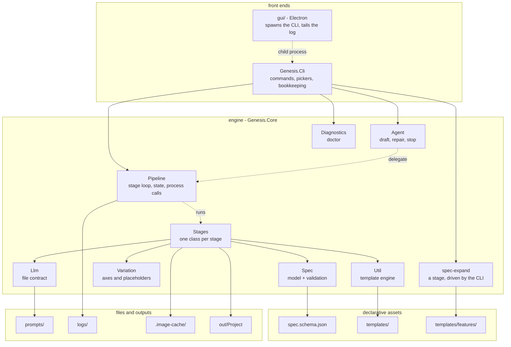

# Components

This is the map to keep open while working on the code. The unit is the module: what each part is
responsible for, what it may depend on, and what breaks if it is wrong. Per-file detail lives in the
generated file map; this chapter tells you which box a behavior belongs in.

## The component graph



## Responsibilities, and failure modes

| Component | Owns | Key types | If it is wrong |
|---|---|---|---|
| **CLI** | the command surface, `GenesisRoot()` resolution, interactive spec/seed pickers, registry + archive, the completion banner | `Program.cs`, plus `InteractiveSelection` (the pickers' helpers, in the engine's `Cli` folder) | wrong files resolved; nothing deep breaks |
| **Pipeline** | the stage loop, resume, timings, the progress log, the external-process wrapper | `PipelineRunner`, `StateStore`, `StageContext`, `Proc`, `ParallelEmit` | runs cannot resume; failures lose their stage |
| **Stages** | everything that reads the lock and writes files | nine `IStage` classes across five files | the app is wrong where that stage is responsible |
| **Spec** | the POCO model and the two-layer validation | `ProjectSpec`, `SpecLoader`, `SpecValidationException` | bad input reaches generation |
| **Variation** | the axis registry, placeholder substitution, derived passwords | `VariationResolver`, `ResolvedVariation` | projects look alike; credentials shift |
| **Util** | the single Scriban surface and its helpers; `DOTNET_ROOT` inference for spawned tools | `TemplateEngine`, `DotnetHost` | every emitted file drifts at once |
| **Llm** | request/response files, automatic vs manual mode, retries, hashing | `LlmBridge`, `LlmModels` | the offline path breaks; bad JSON gets through |
| **Agent** | the draft/repair loop and its stop conditions | `AgentRunner`, `LlmSpecAuthor` | wasted repairs, or a lost spec-only guarantee |
| **Diagnostics** | prerequisite checks and their fixes | `Doctor` | missing prerequisites look like generator bugs |
| **GUI** | presentation, IPC, log reconstruction | `gui/src/main`, `gui/src/renderer` | progress lies; generation is unaffected |
| **Assets** | schema, templates, fragments, design presets, BG maps | JSON + `.sbn` | the app changes with no C# change |

## Dependency rules

```
Cli         -> Agent, Stages, Diagnostics, Pipeline, Llm, Util, Variation, Spec
Agent       -> Llm, Spec        (pipeline injected as a delegate)
Stages      -> Pipeline, Llm, Util, Variation, Spec
Diagnostics -> Pipeline
Pipeline    -> Variation, Spec
Util        -> Variation, Spec
Variation   -> Spec
Spec, Llm   -> (nothing inside Core)
```

Three rules make this hold:

1. **Nothing imports `Stages` except `Cli`.** A stage is a leaf behavior, not a library; even the agent only sees the pipeline as a delegate.
2. **Templates are data, not code.** `Util` renders them; a stage never string-builds C# outside the
   template engine.
3. **The GUI never links the engine.** Its only contract is the CLI process and the log file.

## The five data stores

| Store | Written by | Nature |
|---|---|---|
| the spec + lock | author, `spec-expand` | the only input that matters |
| `out/<Project>/plan/state.json` | runner | disposable resume state |
| `prompts/` | LLM bridge, CLI | audit trail + test fixtures; survives everything |
| `logs/` | runner, stages, CLI | registry, per-project action log, DB lifecycle |
| `.image-cache/` | seed stage | cross-run download cache |

None of them is a database, and none is required for a first run — which is why the tool can be
copied to another machine as a folder plus an exe.

## Where to change what

| Goal | Component | Must also update |
|---|---|---|
| a generated file's contents | `templates/*.sbn` | the build gate proves it; docs if behavior changed |
| a new emitted file | a template + a stage call | `verify`'s manifest expectation if the spec declares it |
| a new spec capability | `spec.schema.json` → `Spec/ProjectSpec.cs` → `SemanticCheck` → emitting stage | the spec contract chapter and the authoring skill |
| a new reusable feature | `templates/features/<name>.json` + feature-gated emission | the feature lists in Chapters 22 and 23 |
| different output between projects | `VariationResolver` | the axis table in [Chapter 12](12-principles.md) |
| how the model is prompted | `Llm`, `LlmSpecAuthor`, the stage's `ExchangeAsync` call | the response schema is part of the contract |
| run order, resume, logging | `Pipeline` | [Chapter 9](09-workflow.md) |
| prereq checks | `Diagnostics/Doctor` | the `doctor` section of [Chapter 4](04-first-run.md) and [Chapter 16](16-runtime.md) |

## Scale, for orientation

The engine is about 5,200 lines of C# across 19 files under `src/`. The largest is the
controllers-and-views stage, because it holds all three provenances. If a change makes one of those
files noticeably bigger, the question is usually "should this be a template?" — the answer has been
yes every time so far.
