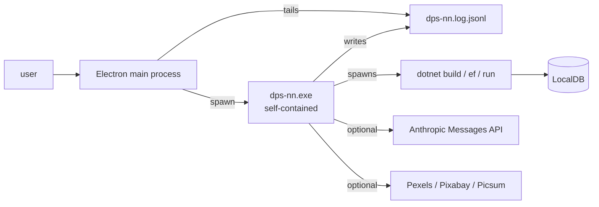

# Runtime, deployment, and the desktop app

The generator has two lives: a repository you build from source, and an installed program a
non-developer runs. They differ in one respect, where files may be written, and that difference
explains most of the odd-looking code in the CLI.

## Two layouts

| | Development (repo) | Installed |
|---|---|---|
| Program files | `src/`, `templates/`, `spec.schema.json` in the checkout | `%LOCALAPPDATA%\Programs\DPS-NN\` — **read-only** |
| Working directory | the repo root | `Documents\DPS-NN\` — **writable** |
| Generated projects | `out/` | `Documents\DPS-NN\out\` |
| Logs, prompts, cache | `logs/`, `prompts/`, `.image-cache/` | under the same workspace |

The rule is that **the installed program never writes next to itself**. Asset resolution checks the
tool's own directory first and the current directory second, so one binary works in both layouts
(ADR-014). The same rule is why `templates/` is copied into the installer instead of embedded.

## Process topology

Three properties fall out of this shape:

- **One pipeline implementation.** The GUI cannot drift from the CLI because it owns no generation
  logic; its correctness is the log's correctness.
- **The GUI is optional.** Every capability is reachable from the CLI; the desktop app adds progress
  reconstruction, pickers and theming.
- **The child processes are the failure surface.** Missing `dotnet-ef`, an old SDK, an unreachable
  LocalDB — all appear as CLI failures, which is why `doctor` exists and why the agent loop can
  classify them.

### The `DOTNET_ROOT` detail

A self-contained `dps-nn.exe` has no `dotnet` parent to set `DOTNET_ROOT`, so global tools it spawns
cannot find a per-user .NET installation. The CLI infers `DOTNET_ROOT` from the `dotnet` on `PATH`
before doing anything else. This is a real bug that shipped once; it is documented here because the
symptom (tools "not found" on a machine where they work in a terminal) looks like a broken install.

## Distribution

| Edition | What it is | Why it exists |
|---|---|---|
| **Full** | NSIS installer: GUI + self-contained CLI + templates + `design/music/` (~1 GB) | the complete experience, including the themed music player |
| **Lite** | the same tree without the music, mirrored automatically to a second repository | shareable/downloadable without a gigabyte of third-party recordings |

The lite edition is produced from the full one by a script that copies the tree, drops
`design/music/`, and substitutes the lite README — a build step, not a fork, so the two cannot drift
in code. Versioning is single-sourced: `VERSION` at the root is stamped into the CLI, the
installer, and this book's cover.

The installer is unsigned, so Windows SmartScreen warns on first run (*More info → Run anyway*).
That is a known, documented cost of not buying a certificate, not a defect.

## Desktop app, in one page

The Electron shell is deliberately thin:

| Part | Responsibility |
|---|---|
| `gui/src/main` | process lifecycle, workspace paths, IPC handlers, spawning `doctor`/`run`/`create`, log tailing, recent projects |
| `gui/src/renderer` | the UI: project picker, progress, terminal (xterm.js), settings, themes, and an interface in six languages plus Standard Galactic and six joke modes |
| shared | types and log-event shapes used on both sides |
| `gui/scripts/` + `gui/electron-builder.yml` | packaging: staging the CLI and its assets into the app, the NSIS installer |

Themes are tokens plus optional skins and wallpapers; new content — wallpapers, logos, footer text,
music — is files, not code, so re-skinning needs no rebuild for the runtime-read parts. The full
contract (IPC channels, window model, theme rules) is `docs/explanation/gui-architecture.md`; the
visual spec is `design/design-specs.md`.

## Operating it

| Question | Where to look |
|---|---|
| Is this machine ready? | `dps-nn doctor` — one line per prerequisite with its fix |
| What did the last run do? | `out/<Project>/dps-nn.log.jsonl` (stage boundaries) and `logs/<Project>/actions.log.jsonl` (details, full exceptions) |
| Which spec produced this app? | `logs/registry.json`, and the archive in `prompts/out/schemas/` |
| Why is the database not re-migrating? | `logs/<Project>/db.json` records the DB name + spec hash already migrated |
| Can it run with no network? | mostly: NuGet packages must already be in the local cache, images need a provider or `--image-pack`, LLM steps need a key or pre-placed response files — and the generated app loads Bootstrap and fonts from CDNs, so it looks unstyled offline |

## Security posture, stated plainly

- **No secrets in inputs.** Seed-user passwords are derived unless the spec sets one, and never
  appear in the seed; the derived values are written to the lock file and to
  `logs/<Project>/seed-credentials.txt`, so treat those as secrets. API keys are environment
  variables only.
- **No hot-linking.** Generated apps serve downloaded images from their own `wwwroot`; the
  `.image-cache/` keeps requests to stock providers to one per phrase.
- **No runtime translation** in generated apps. The only remote calls are the CDN links in the
  layout: Bootswatch/Bootstrap from jsDelivr and the preset's Google Fonts.
- **Third-party content is separated.** The music is not covered by the code license and is excluded
  from the lite edition.

What is *not* hardened — the generated app has no rate limiting, no CSP, no account lockout tuning —
is [Chapter 22](22-limits.md)'s business. A demo app is demo-grade security by
design, and saying so is cheaper than implying otherwise.
