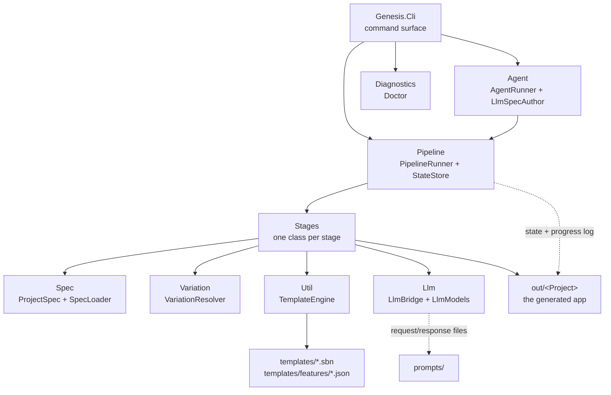

<!-- last-verified: ad7411e -->
# Components — the generator's building blocks

**Diataxis type:** reference. **Source of truth:** the code in `src/`, with per-file purposes in the
generated [file map](file-map.md). This doc is the **module-level** map — what each part is
responsible for and how the parts connect. It deliberately does not list files; that is
[file-map.md](file-map.md)'s job, and it stays generated.

For what a *run produces*, see [generated app anatomy](../explanation/generated-app-anatomy.md);
for the order things happen in, [control flow](control-flow.md).

## The pieces, and how they connect

## Engine modules (`src/Genesis.Core/`)

| Module | Responsibility | Key types | Change it when |
|---|---|---|---|
| `Spec/` | The in-memory model of a spec, and the two-layer validation every spec passes before anything is generated. Layer 1 is `spec.schema.json` (`additionalProperties: false`); layer 2 is the cross-reference rules a schema cannot express — one key per model, relation targets exist, controller models/DTOs exist, redirect targets exist, sort fields exist, area roles exist, every visible property has a `displayName`, every template controller's `Index` has a page. | `ProjectSpec` (+ its section types), `SpecLoader`, `SpecValidationException` | The spec's shape changed (together with `spec.schema.json`) or a new semantic rule is needed. |
| `Variation/` | Deterministic per-project variety: one value per axis, derived from `SHA256(seed + ":" + axis)` so it differs across projects and never changes within one. Also resolves `$variation:*` placeholders and derives seed-user passwords that satisfy Identity's default policy. | `VariationResolver` (the axis registry), `ResolvedVariation` | A new code-style or visual axis should exist ([ADR-004](../adr/adr-004-variation-profile.md)). |
| `Pipeline/` | The stage loop: skip completed stages, mark them done, log start/end/error, record timings, remember which stage threw. Owns the per-project `StageContext` (the only thing a stage sees) and the `Proc` wrapper for external `dotnet` calls with fail-loud semantics. `ParallelEmit` runs emission lanes concurrently and tags their log lines. | `PipelineRunner` (`CanonicalOrder`), `StateStore`, `StageContext`, `Proc`, `DbLifecycleRecord`, `ParallelEmit` | Stage ordering, resume semantics, or logging changes. |
| `Stages/` | One class per stage, each `IStage` and contractually idempotent. Six files hold nine stage classes (`IdentityStage` and friends live in `BuildStages.cs`). | `SpecBuildStage`, `SpecExpandStage`, `ScaffoldStage`, `EmitModelsStage`, `IdentityStage`, `EmitControllersViewsStage`, `SeedStage`, `VerifyStage`, `ReportStage` | What a stage emits, or a new stage is added ([how-to](../how-to/add-a-stage.md)). |
| `Llm/` | ADR-005's file contract: write `prompts/out/<stage>-request.md`, read `prompts/in/<stage>-response.json`, or call the Messages API when `ANTHROPIC_API_KEY` is set — one validation path either way, retried up to 3× with the violations fed back, hash-logged. Model routing (Sonnet for spec work, Haiku for seed rows) is overridable by env. | `LlmBridge` (+ `LlmPendingException`), `LlmModels` | A new LLM exchange, model routing, or a change to the manual flow. |
| `Util/` | The single Scriban surface every emission goes through — helpers that carry variation into every file (`collection_init`, `ns_open`, `clr_type`, `subst`, `ordered_models`), the effective Bootstrap/design preset, feature flags as template booleans, and the `DOTNET_ROOT` fix for the installed exe. | `TemplateEngine`, `DotnetHost` | A template needs a helper, or variation must reach a new kind of emission. |
| `Agent/` | `dps-nn create`: draft → validate → run → repair-the-spec loop, bounded by `--max-repairs`; environment failures (missing SDK, `dotnet-ef`, LocalDB, bad key) stop it before wasting a repair. Every side effect is a delegate, so the loop is unit-tested with fakes. | `AgentRunner`, `ISpecAuthor`, `LlmSpecAuthor`, `AgentResult` | Agent behavior changes ([ADR-013](../adr/adr-013-agent-mode-spec-only-repair.md), [agent mode](../explanation/agent-mode.md)). |
| `Diagnostics/` | `dps-nn doctor`: checks every prerequisite and prints the fix for each one missing. | `Doctor` | A prerequisite is added or its fix command changes. |
| `Cli/` | Shared candidate discovery + numbered menus behind the interactive `--spec` / seed pickers. | `InteractiveSelection` | How candidates are found or presented changes. |

## CLI (`src/Genesis.Cli/`, 20 files)

One entry point, no pipeline logic of its own: it parses the command tree, resolves
`GenesisRoot()` (templates next to the exe, else the cwd), runs `spec-expand` ahead of the stage
loop, does the registry/archive bookkeeping, and prints the completion banner. Commands, options and
exit codes are documented once in the [CLI reference](cli.md).

## Declarative assets (not code)

| Path | Holds | Read by |
|---|---|---|
| `spec.schema.json` | the only authoritative spec shape | `SpecLoader`, `LlmSpecAuthor` (as the LLM's response schema) |
| `templates/*.sbn` (63) | Scriban templates for every emitted file | `TemplateEngine` calls in the stages |
| `templates/*.json` (4) | data the renderer/transforms need: `design-presets.json`, `bg-term-map.json` (scaffolder residue), `identity-bg-map.json` (Identity pages), `log-bg-map.json` (Bulgarian pipeline narration) | stages + `StageContext` logging |
| `templates/features/*.json` (7) | self-contained fragments (models + controllers + views) merged by `spec-expand` | `SpecExpandStage` |
| `fixtures/` | the canonical FaceNote spec, its English twin, and their lock files | dev runs, the agent's reference example |
| `seeds/` | shipped seed data candidates | the CLI's seed picker |
| `utils/claude-skills/` | the two authoring skills for manual spec/seed work in a chat | humans; the spec one is also the agent's drafting prompt |
| `prompts/` | LLM exchange files (`in/`, `out/`) and the permanent archive of specs+seeds | `LlmBridge`, the pickers |
| `logs/` | `registry.json(l)`, per-project `actions.log.jsonl`, `global-errors.jsonl` | CLI bookkeeping, debugging |
| `.image-cache/` | downloaded stock images, keyed by provider+keyword | `SeedStage` (ADR-011) |
| `out/` | generated projects — disposable | everything, never edited by hand |

## The GUI (`gui/`)

An Electron shell that **spawns the CLI** and reconstructs progress from its log — it has no second
implementation of the pipeline ([ADR-010](../adr/adr-010-gui-electron-cli-child.md)). Its own
internal split (main process/IPC, renderer/UI, themes, i18n, packaging) is
[GUI architecture](../explanation/gui-architecture.md); its visual contract is
`design/design-specs.md`.

## Tooling (`scripts/`, `.github/workflows/`)

| Script | Does |
|---|---|
| `generate-file-map.ps1` | regenerates [file-map.md](file-map.md) from `// FILE-MAP:` headers |
| `build-handbook.py` | assembles this handbook from `docs/` (this PDF) |
| `lite-tree.py` | builds the music-free lite mirror tree ([how-to](../how-to/mirror-the-lite-edition.md)) |
| `gen-rich-seed.py` | produces the rich FaceNote seed |

Four workflows: `ci.yml` (build + .NET tests + GUI typecheck/build/tests on Windows),
`handbook.yml`, `release.yml` (Windows installer), `lite-mirror.yml`.

## Where to change what

| Goal | Module |
|---|---|
| A generated file gains/loses a line | `templates/*.sbn` (then [add a template](../how-to/add-a-template.md)) |
| A new capability the spec can describe | `spec.schema.json` → `Spec/ProjectSpec.cs` → the emitting stage → [spec format](spec-format.md) |
| A new capability the spec cannot describe yet, reusable | `templates/features/*.json` + the stage that consumes it |
| A new ordering/gate in the run | `Pipeline/Pipeline.cs` + [control flow](control-flow.md) |
| Different output between projects | `Variation/VariationResolver.cs` |
| How the model is asked for a spec/seed | `Llm/`, `Agent/LlmSpecAuthor.cs`, `Stages/SpecStages.cs`, `Stages/SeedStage.cs` |
| The app's Bulgarian text | `templates/` + the spec's `displayName`/`validations`, never a runtime translation layer |
