<!-- last-verified: e95fedf -->
# Control flow — the 9-stage pipeline

**Diataxis type:** reference. **Source of truth:** `PipelineRunner.CanonicalOrder` in
`src/Genesis.Core/Pipeline/Pipeline.cs`, cross-checked against each stage class in
`src/Genesis.Core/Stages/*.cs`. This doc replaces `docs/architecture.md` (retired in this commit —
see `plan/archive/task-a-doc-architecture.md` decision D2).

## Pipeline flow

`run --all` is **seven stages**: `PipelineRunner` drives `scaffold` → … → `report` in
`CanonicalOrder`. `spec-expand` runs once ahead of that loop (in the CLI, not in the runner), and
`spec-build` is not part of `run --all` at all — it is the separate `spec build` command that writes
the spec file the run then consumes. Each code-emitting stage ends in its own `dotnet build` gate
(not shown per-edge below — see the stage table).

```mermaid
flowchart LR
  notes["notes.md"] -->|"spec build command\n(LLM; separate from run --all)"| spec["project-spec.json"]
  spec -->|"spec-expand\n($variation:* resolved, ADR-004)"| lock["project-spec.lock.json"]
  lock --> scaffold["scaffold"]
  scaffold --> emitModels["emit-models"]
  emitModels --> identity["identity"]
  identity --> emitCV["emit-controllers-views"]
  emitCV --> seed["seed"]
  seed --> verify["verify"]
  verify --> report["report"]
```

The nine names in `CanonicalOrder` are still the vocabulary for `--from`, for the stage table below,
and for the standalone one-stage commands (`dps-nn scaffold`, …) — it is the *runner's* list that is
seven long.

**Agent mode** (`dps-nn create`, ADR-013) wraps this whole flow in a loop: an LLM drafts the
spec from a free-text description, the pipeline runs, and on failure the LLM repairs the *spec*
(never the generated code) and the run starts over — bounded, with environment errors stopping
it immediately. The loop's own diagram lives in `docs/explanation/agent-mode.md`.

## Stage table

| # | Stage | Emits | Build gate | Checkpoint key |
|---|---|---|---|---|
| 1 | `spec-build` | Draft `project-spec.json` from `notes.md` via LLM. **Not part of `run --all`**: it is the `spec build` command, run before the pipeline. A `--from spec-build` (or any name outside the seven-stage loop) starts no stage at all. | — (no code yet) | — (writes `<out>/.specbuild/state.json`, not the per-project resume chain) |
| 2 | `spec-expand` | `project-spec.lock.json` — the **only** spec every later stage reads (ADR-001). Deterministic feature expansion, `$variation:*` placeholder resolution (ADR-004), seed-user password resolution, one optional LLM review pass. | — | `spec-expand` |
| 3 | `scaffold` | `dotnet new sln` + `mvc`, `sln add`, NuGet package adds, first build. Idempotent: `.csproj` presence short-circuits `dotnet new`. | ✅ (the scaffold build itself) | `scaffold` |
| 4 | `emit-models` | Models, DTOs, `{Project}Context`, custom validation attributes — all Scriban-rendered. BG error messages come straight from the spec; templates hold no UI literals of their own. | ✅ | `emit-models` |
| 5 | `identity` | `aspnet-codegenerator identity` scaffold → `ApplicationUser` (template) → `BgIdentityErrorDescriber` (template) → static EN→BG replacement map over the scaffolded Identity Razor pages (ADR-002 — two *different* Bulgarian mechanisms on purpose) → roles + seed users + area/route registration. | ✅ | `identity` |
| 6 | `emit-controllers-views` | Controllers from three provenances — `generatedBy=scaffold` (codegen + regex-applied deviations, ADR-006), `generatedBy=template` (Scriban), and the hand-written `ApplicationUser` controller (server-side `AdminCannotDeleteSelf`) — plus their views. | ✅ | `emit-controllers-views` |
| 7 | `seed` | LLM-generated seed rows as symbolic refs, never numeric IDs (ADR-003) → image download (Pexels/Pixabay/Picsum/local pack) → `Data/SeedData.cs` → **always** followed by `ef migrations add Initial` + `ef database update`. | ✅ | `seed` |
| 8 | `verify` | Nothing — this is the blocking gate (see below). Any failure throws; state is **not** marked done. | ✅ (first check) | `verify` |
| 9 | `report` | `wwwroot/output/project-summary.json` — resolved `codePointer`s (file + line range + snippet) for the downstream documentation toolchain. Only runs if the spec's `outputReport` section is present. | — | `report` |

## Verify-gate sequence (cheapest → most expensive)

`VerifyStage.RunAsync`, in order — cheaper checks fail fast before an app is ever booted:

1. Clean `dotnet build`.
2. `dotnet ef database update` clean.
3. **Spec manifest check** — every file the spec declares (models, DTOs, controllers, identity
   files, views, seed output) actually exists on disk. Cheap; catches emission bugs with no
   webserver involved.
4. App boots (Kestrel on a random free port).
5. `GET /` — hard-required; a broken landing page is a hard failure, never skipped.
6. Every discovered **public** route (every `cardGrid` page) fetched anonymously; non-200 fails.
7. **Anonymous refusal** — every protected route (admin-area `adminTable` pages + each login-only
   Client-area feature page) requested with no cookie and no redirect-following; it must answer
   401/403 or a 302 to `/Identity/Account/Login` or `AccessDenied`. The `[Authorize]` it tests is
   emitted by `emit-controllers-views` (`InjectAreaAuthorization`).
8. Real form login as the seeded admin (antiforgery token + cookie jar), then every discovered
   **authenticated** route (every `adminTable` + each enabled Client-area feature page) fetched;
   non-200 fails. Steps 6–8 collect failures and throw once with the full list (changelog 141 —
   before it, a non-200 route was only logged and skipped).
9. **English visible-text leak scan** over every page fetched above that answered 200 (steps 5–8,
   the *whole* route surface — not one page per kind). Enforces the Bulgarian-only-UI requirement. **Skipped
   entirely** (not merely non-fatal) for a non-Bulgarian project — `meta.language != "bg"`. The
   report (`wwwroot/output/verify-language-report.txt`) is written either way, pass or skip.

## Resume semantics

State lives at `{out}/{Project}/plan/state.json` (`StateStore`, ADR-001) — a flat
`completedStages: string[]`. On `run --all` (no `--from`), `PipelineRunner.RunAllAsync` skips any
stage already in `completedStages`; each successfully completed stage calls `MarkDone` immediately
after it returns. Passing `--from <stage>` forces that stage (and everything after it in the
runner's seven) to re-run regardless of state; `spec-expand` is only covered by its own
already-done check, and a name the runner does not know runs nothing. Every stage is contractually
idempotent (`IStage.RunAsync` doc contract) — a resumed or forced re-run must detect and skip
already-done work internally, not just at the pipeline level.

**LLM pause (exit code 3).** A stage needing an LLM response that hasn't been supplied (no
`ANTHROPIC_API_KEY`, no pre-placed response file) throws `LlmBridge.LlmPendingException`. The CLI
catches it, prints instructions, and exits with code **3** — a distinct signal from "stage failed"
(any other non-zero). The run is resumed with `--resume` after the response file is filled at
`prompts/in/<stage>-response.json` (ADR-005's file contract).

## What this doc does not cover

*Why* the pipeline is staged, resumable, and verify-gated this way is
`docs/explanation/architecture-decisions.md` (which links the specific ADRs). The GUI's own
progress-reconstruction logic against this same `dps-nn.log.jsonl`/`state.json` pair is
`docs/explanation/gui-architecture.md`.
